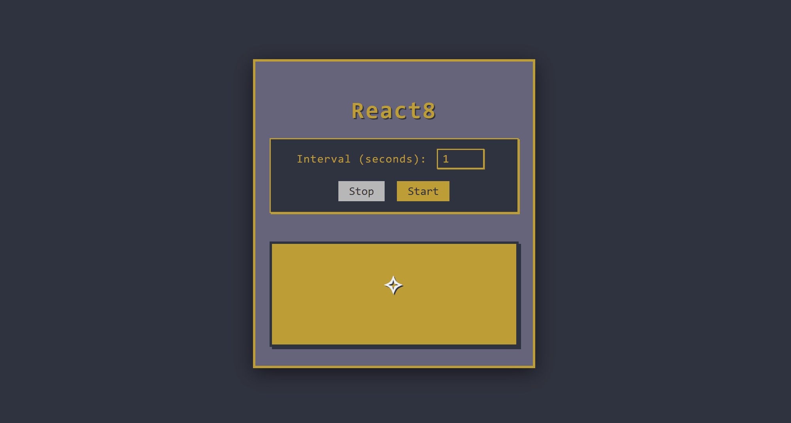

<div align="center">

# React8

**Reaction and agility trainer for athletes.**
Random cues in 8 directions at your pace. Move as soon as you see one, or hear it.

**Live Site:** [https://alex-gamero.github.io/React8/](https://alex-gamero.github.io/React8/)




</div>

---

## Features
| | |
|---|---|
| 🧭 **8 directions** | Up, down, left, right and all four diagonals, picked at random |
| 🔊 **Voice cues** | Every direction is also called out loud, so you don't need to watch the screen |
| ⏱️ **Your pace** | Set the time between cues in seconds |
| 🎚️ **Adaptive audio** | Voice cues speed up when the interval is short |
| 📱 **Train anywhere** | Works on your phone or computer, no install needed |

---

## How it works
1. Set the interval in seconds.
2. Press **Start**.
3. Move in the direction shown (and called out) as fast as you can.
4. Press **Stop** when you're done.

Great for footwork drills in volleyball, basketball, soccer, tennis or any sport where first-step speed matters.

---

## 🛠️ Tech Stack
- **HTML5**
- **CSS3**
- **Vanilla JavaScript** with the HTML Audio API
- **Hosting:** GitHub Pages

### Project structure
```
React8/
├── index.html   # Trainer UI
├── style.css    # Styling
├── logic.js     # Random cues, timing, audio
└── audio/       # Voice cue for each direction
```

### Run locally
```bash
git clone https://github.com/alex-gamero/React8.git
cd React8
# open index.html in your browser
```

---

## Coming Soon
- More training modes (reaction + memory + pattern drills)
- Vibration cues
- Stats tracking (best time, average reaction)

---

## Contributing
Got an idea or found a bug? Open an **issue** or submit a **pull request**!

<div align="center">

Made with ⚡ by [Alex Gamero](https://github.com/alex-gamero)

</div>
