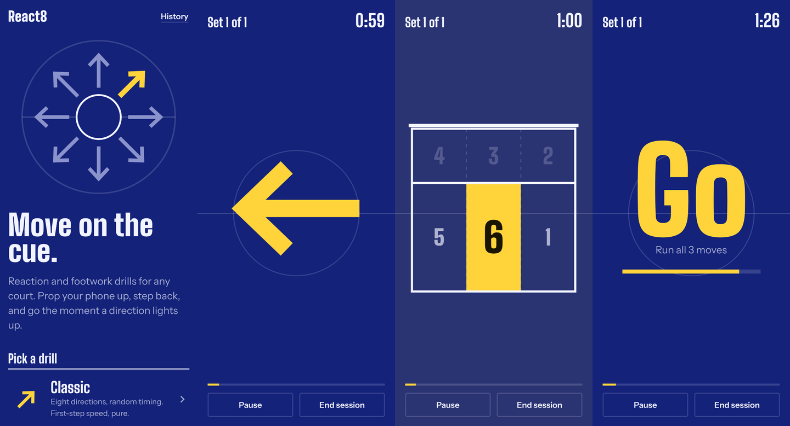

<div align="center">

# React8

**Reaction and agility trainer for athletes.**
Prop your phone up, step back, and move the moment a cue lights up.

**Live Site:** [https://alex-gamero.github.io/React8/](https://alex-gamero.github.io/React8/)




</div>

---

## Drills

| Mode | What you train |
|---|---|
| **Classic** | Eight directions at random gaps. Pure first-step speed. |
| **Go / No-Go** | Yellow arrow means go, pink means hold. Trains decisions, not just speed. |
| **Memory chain** | Watch a short sequence of moves, then run it back from memory. |
| **Volleyball zones** | Court zones 1–6 called at random, with a back-row-only option for liberos and defenders. |

Every mode supports:

- **Random timing** between a fastest and slowest gap, so you react instead of falling into a rhythm.
- **Sets and rest** with countdowns, plus Quick and Workout presets.
- **Cue sound**: recorded voice, Spanish voice, beeps, or silent.
- **Screen flash** on each cue, for catching it in your peripheral vision.
- **Session history**: day streak, minutes per day for the last week, and every session logged on your device.

It's also built for the gym floor:

- **Installable and offline.** Add it to your home screen and it works with no signal.
- **Screen stays awake** during a drill.
- **Huge cues** readable from a few metres away.
- **Auto-pause** if you leave the app.
- **Keyboard support** on laptops: `Space` pauses, `Esc` ends.

## How it works

1. Pick a drill and a preset, or tune the timing yourself.
2. Press **Start drill** and find your ready stance during the countdown.
3. Move on each cue, then recover to the middle.
4. Check your summary and history when you're done.

## Tech stack

- **React 19 + TypeScript**, built with **Vite**
- **Web Audio API** with preloaded clips and synthesised beeps, for low-latency cues (Speech Synthesis for Spanish and zone calls)
- **Screen Wake Lock API**
- **vite-plugin-pwa** (Workbox) for offline use and install
- **Vitest** for the drill engine
- Self-hosted fonts: Big Shoulders Display and Instrument Sans
- Deployed to **GitHub Pages** with GitHub Actions

### Project structure

```
React8/
├── public/
│   └── audio/            # Recorded voice cue for each direction
├── src/
│   ├── engine/           # Framework-free drill engine
│   │   ├── plan.ts       # Builds a session: phases, cue timing, modes
│   │   ├── runner.ts     # Plays a plan against a clock (pause, stop, summary)
│   │   └── engine.test.ts
│   ├── audio/sound.ts    # Web Audio clips, beeps, speech fallback
│   ├── lib/              # Modes and presets, storage, wake lock
│   ├── components/       # Arrow, rosette, court diagram, controls
│   ├── screens/          # Home, Setup, Run, Summary, History
│   └── styles/
└── .github/workflows/    # Build, test and deploy to GitHub Pages
```

The engine is pure TypeScript with no React in it. `planSession()` turns a config into a timed plan. `DrillRunner` plays that plan against any clock, which is how the tests run whole sessions in milliseconds.

### Run locally

```bash
git clone https://github.com/alex-gamero/React8.git
cd React8
npm install
npm run dev
```

Other scripts: `npm test` runs the engine tests, `npm run build` creates a production build, and `npm run preview` serves that build.

---

## Coming soon

- **Camera tracking**: pose detection in the browser checks which way you moved and measures your real reaction time, with no tapping.
- Per-direction reaction heatmap ("you're slower going back-left").
- Team mode for running drills with a group.

---
